검색창에서 말로 데이터를 찾고 고치는 Salesforce AI 동료. 예시 org에서 직접 켜 보고 확인한 내용이에요.

> **오늘 이야기할 것**
>
> - **Coworker는** 화면 맨 위 검색창 옆 "**✦ 질문**"으로 쓰는 AI 동료예요. 말로 물으면 데이터를 찾아 답하고, 허용하면 레코드도 고쳐요.
> - **직접 설계해서 만드는 Agentforce 에이전트와 비교**하면 이해가 쉬워요. 에이전트는 업무 규칙을 미리 설계해 두고, Coworker는 그때그때 데이터를 탐색해 답해요.
> - **세팅은 쉬워요.** 권한을 주고 버튼을 누르면 기반 설정은 자동으로 끝나요. 남은 건 데이터 범위와 사용자 지정이에요.

## 1. Coworker란?

- **한 줄 정의**: Salesforce 화면 맨 위 검색창 옆 "**✦ 질문**" 버튼으로 쓰는 AI 동료예요. 평소 말로 물으면 레코드 목록이 아니라 정리된 답을 줘요.
- **할 수 있는 일**: 입력창 아래에 세 가지 모드가 있어요.
  - **찾기**: "New 상태 케이스 보여줘" → 조회해서 표로 답해요.
  - **상황 파악**: 내 업무에서 무엇이 바뀌었는지 요약해요.
  - **계획**: 할 일을 정리하고, 허용하면 실제 작업(레코드 생성·수정, Flow 실행)까지 해요.
- **이어서 묻기**: 앞 대화를 기억해요. "그중에 A사 것만"처럼 계속 좁혀 갈 수 있어요.
- **권한 그대로**: 사용자가 원래 볼 수 있고 고칠 수 있는 데이터만 다뤄요.
- **상태**: 2026년 5월 발표, 현재 **베타**예요. 대상 에디션은 Enterprise, Unlimited, Agentforce 1이에요.
- **쓸 수 있는 곳**: 지금은 Salesforce 화면이에요. Slack, Teams, ChatGPT, Claude, 데스크톱 앱은 올해 안에 나올 예정이라고 해요.

### 실제 화면: "✦ 질문"을 누르면

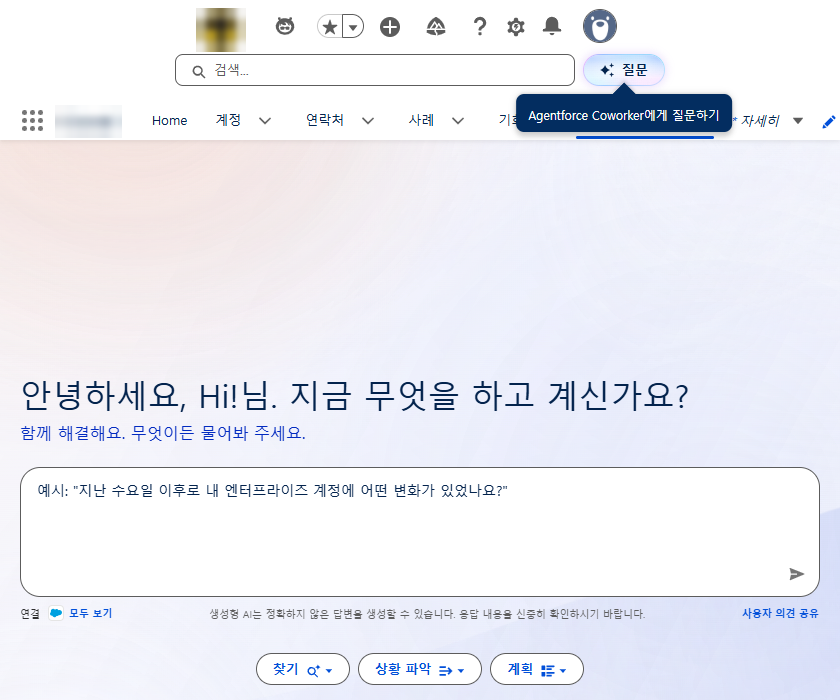

- 검색창 옆 **✦ 질문**(툴팁 "Agentforce Coworker에게 질문하기")을 누르면 대화 화면이 열려요.
- 가운데 입력창에 평소 말로 쓰면 돼요. 아래 **찾기 · 상황 파악 · 계획** 버튼으로 모드를 고를 수 있어요.
- 입력창 아래 **연결: Salesforce**는 지금 Coworker가 찾는 데이터 범위예요(설정 화면의 데이터 관리와 같아요).

### Coworker의 정체: Agentforce 위에서 돌아가는 에이전트 하나

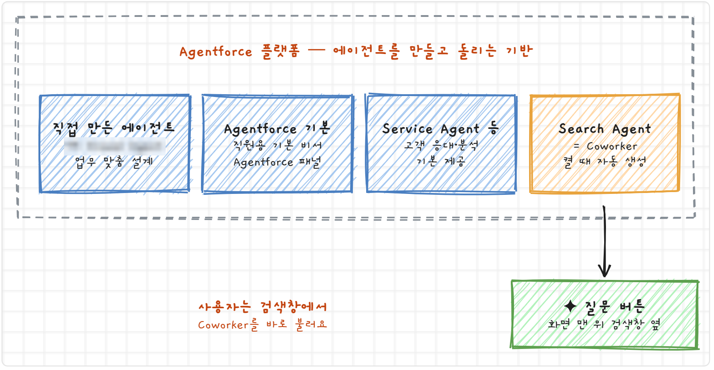

- **Agentforce**는 에이전트를 만들고 돌리는 **플랫폼 전체**예요. org마다 여러 에이전트가 있을 수 있어요(예시 org는 11개).
- Coworker를 켜면 `Search Agent`라는 에이전트가 **자동으로 하나 생겨요**. Coworker는 이 에이전트를 검색창에 붙여 둔 거예요.
- 그래서 "Coworker vs Agentforce"는 사실 "**Coworker vs 직접 만든 커스텀 에이전트**"의 비교예요. 다음 장에서 둘이 질문을 어떻게 다르게 처리하는지 볼게요.

## 2. 에이전트와 비교하면 더 쉬워요

같은 질문 "**처리해야 할 케이스 알려줘**"를 두 쪽에 던지면 답이 달라요. 내부에서 질문을 처리하는 방식이 다르기 때문이에요.

예시는 "처리해야 할 케이스 = New 상태 케이스"라는 업무 규칙을 넣어 직접 만든 커스텀 에이전트예요. 다른 프로젝트라면 이 자리에 그 프로젝트의 에이전트와 규칙을 넣어 보면 돼요.

### 2-1. 직접 만든 에이전트: Router → Subagent → Action

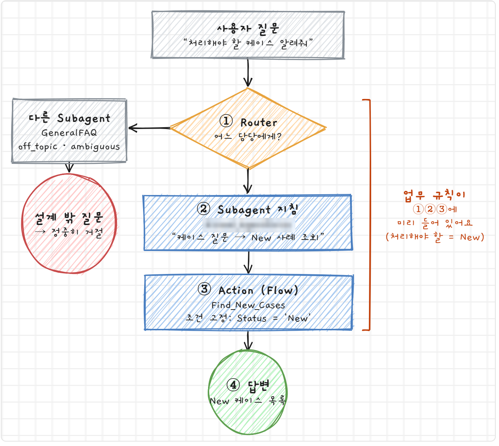

- **① Router**: 분류 전용 모델이 각 Subagent의 설명과 질문을 비교해서 담당을 골라요.
- **② Subagent 지침**: "케이스 질문이 오면 New 사례 조회를 실행한다"처럼 일하는 방법이 적혀 있어요.
- **③ Action**: 실제 데이터를 꺼내는 Flow예요. 조건 `Status = 'New'`가 고정돼 있어요.
- 예시의 "처리해야 할 = New"처럼 **업무 규칙이 세 곳에 미리 들어 있어서** 누가 물어도 같은 답이 나와요. 설계하지 않은 질문은 off_topic으로 빠져서 답하지 못해요.

### 2-2. Coworker: 설계된 길 없이 그때그때 탐색

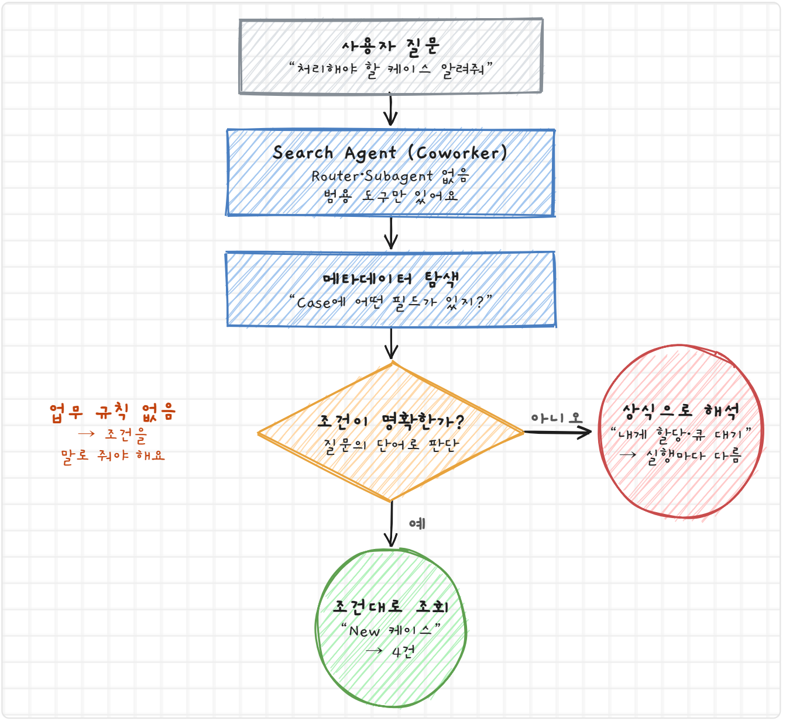

- 업무별 Router와 Subagent가 없고 **범용 도구**만 있어요.
- 질문을 받으면 **메타데이터를 먼저 살펴보고** 질문에 맞는 **조회 조건을 즉석으로 만들어** 실행해요. 비개발자 대신 SOQL을 써 주는 셈이에요.
- 회사만의 업무 용어는 몰라요. **조건을 말로 분명하게** 줘야 원하는 답이 나와요.

### 2-3. 실제로 물어본 결과 (예시 org, 관리자 계정)

**Q1. "상태가 New인 케이스 목록 보여줘"**

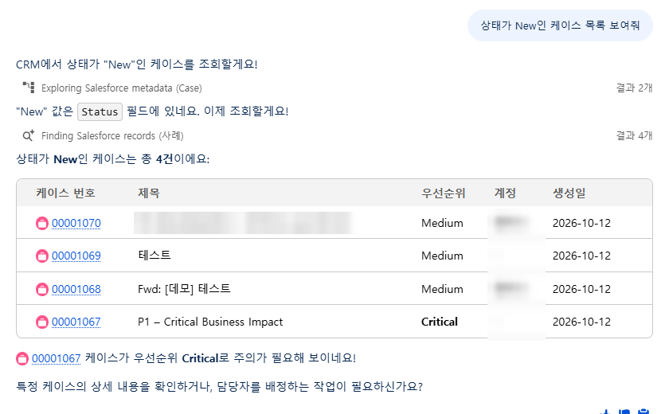

답변 위에 진행 단계가 보여요.

1. **Exploring Salesforce metadata (Case)** → "New 값은 Status 필드에 있네요"
2. **Finding Salesforce records** → 결과 4개

메타데이터를 보고 조건을 스스로 찾아서 **New 케이스 4건**을 표로 보여줬어요. 조건을 분명히 말하면 정확해요.

**Q2. (이어서) "그중에 A사 계정 것만 추려줘"**

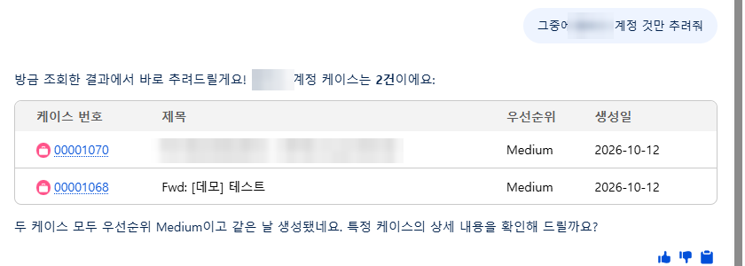

"방금 조회한 결과에서 바로 추려드릴게요!" — 다시 조회하지 않고 **앞 결과를 기억해서 2건**으로 좁혔어요.

**Q3. "내가 처리해야 할 케이스 알려줘"**

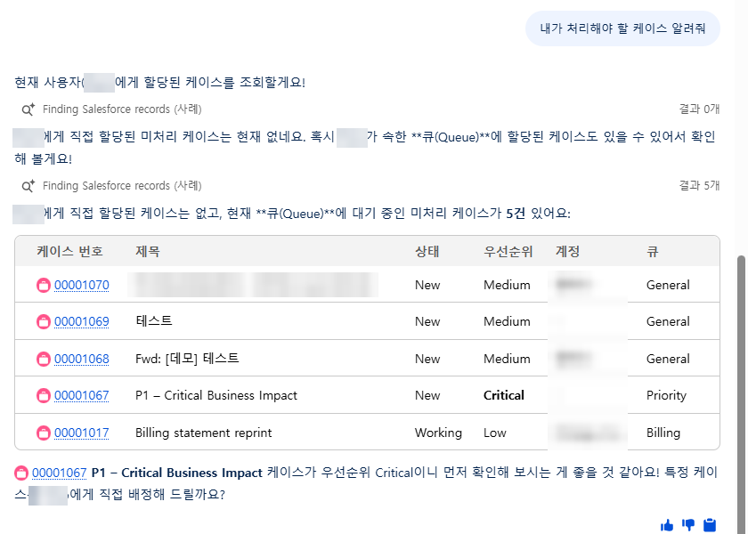

"처리해야 할"을 "**나에게 할당된 케이스**"로 해석 → 0건 → 스스로 **큐(Queue) 대기 케이스**까지 넓혀서 5건을 보여줬어요.

5건 중 **00001017은 Working 상태**예요. 예시 에이전트의 규칙(처리해야 할 = New)과 달라요.

**같은 질문을 앞서 한 번 더 했을 때는** 0건에서 멈추고 "New/Open도 볼까요?"라고 되물었어요. 해석을 그때그때 하기 때문에 **실행마다 답이 달라질 수 있어요.**

### 2-4. 한눈에 비교

| | 직접 만든 Agentforce 에이전트 | Coworker (Search Agent) |
|---|---|---|
| 질문 해석 | Router가 **미리 정한 담당**으로 분류 | AI가 **그때그때** 해석 |
| 업무 규칙 | Subagent 지침과 Flow에 **고정** | 없음. 사용자가 말로 조건을 줘야 함 |
| 데이터 조회 | 설계된 액션(Flow/Apex)만 | 메타데이터를 보고 조회 조건을 즉석 생성 |
| 들어가는 곳 | Agentforce 패널에서 에이전트 선택 | 검색창 옆 "✦ 질문" |
| 만드는 사람 | 프로젝트 팀이 주제·지침·액션을 설계 | Salesforce가 만든 것을 켜기만 함 |
| 같은 질문 반복 | 항상 같은 답 | 해석에 따라 답이 달라질 수 있음 |
| 장점 | 일관성, 업무 프로세스 반영 | 범위가 넓음, 설계 없이 바로 씀 |
| 약점 | 설계 밖 질문은 못 함 | 회사 용어·관행을 모름 |
| 비유 | 업무 매뉴얼을 숙지한 담당 직원 | DB는 잘 알지만 팀 관행은 모르는 신입 직원 |

## 3. 세팅 방법

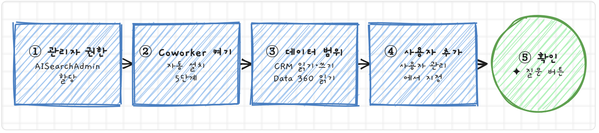

### 필요한 라이선스와 권한 (예시 org에서 조회한 API 이름)

| 대상 | 권한 세트 라이선스 | 권한 | 수량 |
|---|---|---|---|
| 관리자 (설정하는 사람) | Agentforce Coworker Setup `AISearchAdminPsl` | Agentforce Coworker 관리자 `AISearchAdmin` + Data 360 Admin 또는 Architect | org마다 다름 |
| 사용자 (쓰는 사람) | Agentforce Coworker `AISearchUserPsl` | Agentforce Coworker 사용자 `AISearchUser` + `Access_Ai_Search` 권한 세트 그룹 | org마다 다름 |

- 관리자 권한 세트를 할당하면 Setup 라이선스가 자동으로 따라와요.
- `Access_Ai_Search` 그룹은 Coworker를 켤 때 자동으로 생겨요. 사용자 할당은 설정 화면의 **사용자 관리**에서 하는 게 편해요(라이선스, 그룹, 데이터 공간 권한이 한 번에 들어가요).
- Einstein 설정에서 **Beta Generative AI Models**를 켜 두라는 안내가 있어요.
- 라이선스 수만큼만 사용자를 추가할 수 있어요. 예시 org는 관리자용·사용자용이 각각 5개라 **최대 5명**이에요. 내 org 수량은 설정 화면의 **모니터 라이선스**에서 보여요.

## 4. 설정 화면 살펴보기

설정 → 빠른 찾기 "Agentforce Coworker"로 들어가는 화면이에요. 위에서부터 차례로 볼게요.

### ① Agentforce Coworker 설정 — 자동 설치

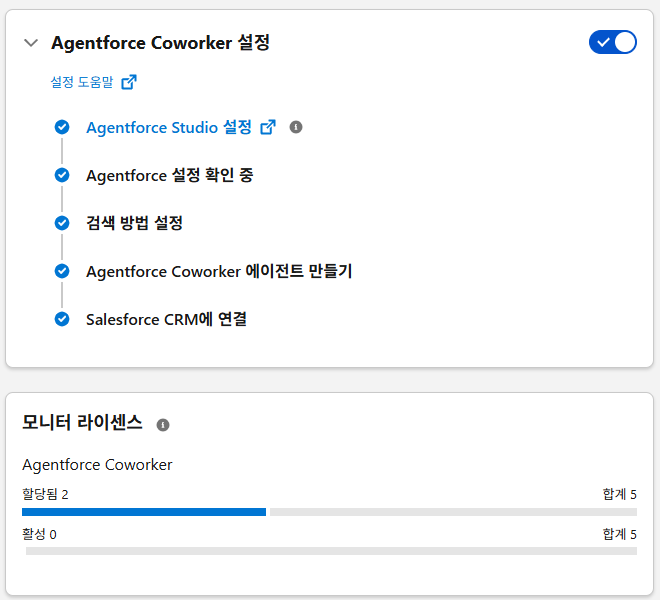

Turn On을 누르면 아래 5단계가 자동으로 끝나요.

| 단계 | 하는 일 |
|---|---|
| Agentforce Studio 설정 | 에이전트를 만들고 돌리는 기반을 켜요 |
| Agentforce 설정 확인 | org에서 쓸 수 있는지 점검해요 |
| 검색 방법 설정 | AI 검색용 색인을 준비해요 |
| Coworker 에이전트 만들기 | `Search Agent`를 만들어요 |
| Salesforce CRM에 연결 | CRM 데이터를 검색 대상으로 붙여요 |

### ② 모니터 라이선스

**합계**: 받은 라이선스 수 · **할당됨**: 사용자 관리에서 추가한 사람 수 · **활성**: 실제로 써 본 사람 수 (예시 org: 5 · 2 · 0)

### ③ 데이터 관리 `옵션`

**Coworker가 무엇을 읽고 무엇을 고칠 수 있는지** 정해요.

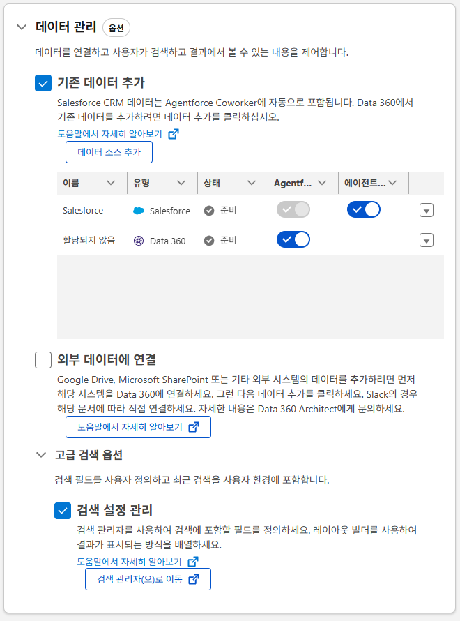

| 열 | 허용하는 것 |
|---|---|
| Agentforce Coworker에 대해 활성화됨 | **읽기**: 검색해서 답할 수 있어요 |
| 에이전트 작업 | **쓰기**: 레코드를 만들거나 고칠 수 있어요 |

- **Salesforce 행**: CRM 데이터예요. 읽기는 항상 켜져 있어요(회색 잠김). 쓰기는 선택이고, 예시 org에서는 **쓰기도 켰어요**.
- **할당되지 않음 행**: Data 360 데이터 중 이름 붙은 출처로 묶지 않은 것들이에요. 읽기를 켰지만 지금은 검색용 데이터가 거의 없어서 효과가 거의 없어요.
- **외부 데이터에 연결**: Google Drive, SharePoint, Slack 문서까지 찾게 하는 단계예요. 예시 org에서는 아직 안 했어요.
- **검색 설정 관리**: 검색할 필드와 결과에 보일 컬럼을 정해요. 기본값으로 동작해요.

### ④ 사용자 관리 — 필수

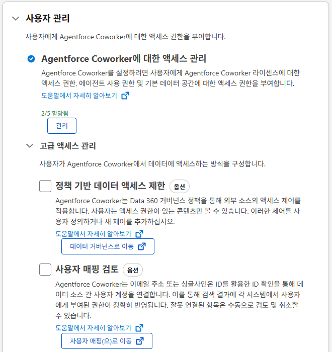

**관리** 버튼으로 Coworker를 쓸 사람을 추가해요. 라이선스, 에이전트 사용 권한, 데이터 공간 권한이 한 번에 들어가요. 여기 없는 사람의 검색창에는 "✦ 질문"이 안 보여요.

### ⑤ 고급 액세스 관리 `옵션`

- **정책 기반 데이터 액세스 제한**: 외부 문서에 누가 접근할 수 있는지 Data 360 정책으로 막아요.
- **사용자 매핑 검토**: Salesforce 계정과 외부 시스템 계정을 같은 사람으로 이어 줘요(이메일·SSO 기준).

둘 다 **외부 데이터를 붙일 때만** 필요해요. CRM 데이터는 원래 Salesforce 권한을 그대로 따라요.

## 5. 써 보기

- **들어가기**: 화면 맨 위 검색창 옆 "**✦ 질문**"을 눌러요. 입력창 아래에 찾기·상황 파악·계획 모드가 있어요.
- **조건은 구체적으로**: "처리해야 할 케이스"보다 "상태가 New인 케이스"처럼 물어야 정확해요.
- **이어서 묻기**: 답 아래에 그대로 이어서 써요. "그중 첫 번째 상세 보여줘", "우선순위순으로 정렬해 줘". Coworker가 다음 할 일을 제안하면 "응, 해 줘"라고 답해도 돼요.
- **수정 요청**(데이터 관리에서 쓰기를 켠 경우): "00001070 Working으로 바꿔줘" → 수정안이 나오고 **확인(Confirm)을 눌러야 반영**돼요.
  - 한 번에 최대 15건까지 고칠 수 있어요.
  - 확인을 누르는 순간 사용자 권한을 검사해요. 원래 못 고치는 레코드는 Coworker로도 못 고쳐요.

## 6. 아직 확인 안 된 것 · 유의점

- **SOQL만 쓰는 건 아니에요.** 검색 색인으로 찾기도 하고, Data 360·외부 문서까지 넓힐 수 있어요. "SOQL을 대신 써 준다"는 CRM 데이터 조회에 한정된 비유예요.
- **에이전트와 경쟁 관계가 아니에요.** Salesforce는 Coworker를 다른 에이전트에게 일을 넘기는 입구로 소개해요. 다만 Coworker가 직접 만든 에이전트를 실제로 호출하는지는 확인하지 않았어요.
- **Coworker에 업무 규칙을 넣을 수 있는지**는 아직 몰라요. 이번에 확인한 건 기본 상태의 동작뿐이에요.
- **수정 기능**은 설정만 켰고 실제로 시험하지는 않았어요.
- **기존 Agentforce 패널과의 관계**(대체인지 공존인지), **가격**, **정식 출시 일정**은 공식 설명을 찾지 못했어요.
- **베타**라서 이름, 권한, 동작이 정식 출시 전에 바뀔 수 있어요.

## 7. 출처

- **공식 문서** Agentforce Coworker (Beta) 홈: <https://developer.salesforce.com/docs/data/agentforce-coworker/guide/agentforce-coworker-a-home.html>
- **공식 문서** Set Up Agentforce Coworker (Beta): <https://developer.salesforce.com/docs/data/agentforce-coworker/guide/agentforce-coworker-a-setup-home.html>
- **공식 문서** Navigate the Agentforce Coworker Experience (Beta): <https://developer.salesforce.com/docs/data/agentforce-coworker/guide/agentforce-coworker-navigate-the-experience.html>
- **공식 문서** Customize the Agentforce Coworker Results and Layout (Beta): <https://developer.salesforce.com/docs/data/agentforce-coworker/guide/agentforce-coworker-customize-results-and-layout.html>
- Trailhead — Quick Start: Agentforce Coworker: <https://trailhead.salesforce.com/content/learn/modules/quick-start-agentforce-coworker>
- Salesforce 공식 블로그 — Meet Agentforce Coworker: <https://salesforce.com/blog/agentforce-coworker-salesforce-ai-teammate>
- Salesforce Admins 블로그: <https://admin.salesforce.com/blog/2026/meet-your-users-new-ai-teammate-introducing-agentforce-coworker>
- **공식 문서** Turn On Agentforce Coworker (Beta): <https://developer.salesforce.com/docs/data/agentforce-coworker/guide/agentforce-coworker-turn-on-infrastructure.html>
- **공식 문서** Give Users Access to Create and Update Records: <https://developer.salesforce.com/docs/data/agentforce-coworker/guide/agentforce-coworker-allow-coworker-update-records.html>
- SalesforceBen — Agentforce Coworker 발표: <https://salesforceben.com/salesforce-announces-agentforce-coworker-ai-in-every-search-bar>
- Salesforce Bolt — Hands On With Agentforce Coworker: <https://salesforcebolt.com/2026/09/hands-on-with-agentforce-coworker-salesforce.html>
- 예시 org 확인 자료: 커스텀 에이전트 설정 파일, BotDefinition·라이선스·권한 조회, Coworker 실제 질의 결과 (2026-10-13)
